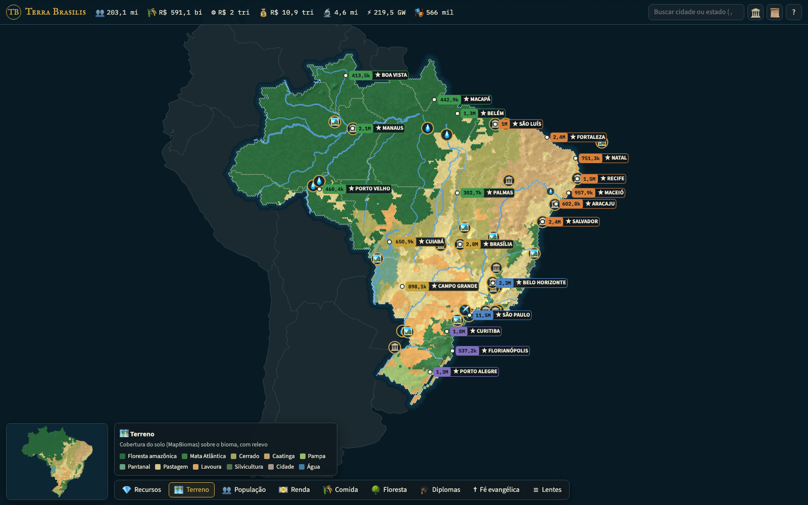

# Terra Brasilis

**Abrir o mapa: https://letsdata.github.io/terra-brasilis/** · um projeto do [Let's Data](https://letsdata.ai)



O Brasil como tabuleiro de jogo de estratégia, montado com dados públicos. Inspirado no
mapa dos Estados Unidos que Andrej Karpathy publicou em 26/11/2026 (karpathy.ai/usaciv);
este é outro projeto, escrito do zero para o Brasil, sem usar o código dele.

- 15.790 hexágonos de terra, 25 km entre lados opostos, projeção de áreas iguais.
- 5.571 municípios com população, PIB, colheita, empregos por setor, Censo 2022, cobertura do solo,
  desastres e IDHM; mais de 5 mil pontos (usinas, Patrimônio Mundial, áreas protegidas, portos etc.).
- Lentes, painel de município e de estado, Conselho (frases calculadas dos dados) e Explorador
  (dispersão e tabela de quaisquer duas colunas).

## Rendimentos em linguagem de jogo

| Jogo | Dado real |
|---|---|
| Comida | Valor adicionado da agropecuária (PIB dos Municípios) |
| Produção | Valor adicionado da indústria |
| Ouro | PIB |
| Ciência | Empregos formais em informação, comunicação e serviços científicos e técnicos (CEMPRE, seções J e M) |
| Cultura | Empregos formais em artes, cultura, esporte e recreação (CEMPRE, seção R) |
| Energia | Potência das usinas em operação (ANEEL) |
| Distritos | Setores em que o município tem, proporcionalmente, 1,5 vez ou mais empregos que o Brasil |
| Maravilhas | Regras no Almanaque da página (Unesco, maiores usinas, parques mais visitados...) |

## Como refazer

```
uv venv .venv && uv pip install --python .venv/bin/python shapely numpy pandas requests openpyxl pyproj pyshp xlrd
.venv/bin/python scripts/grade.py            # grade de hexágonos
.venv/bin/python scripts/elevacao.py         # altitude (Open-Meteo; OpenTopoData quando bate o limite)
.venv/bin/python scripts/ibge_base.py        # municípios, PIB, malhas  (e ibge_agro.py, ibge_biomas.py)
.venv/bin/python scripts/social_sidra.py     # Censo 2022 e CEMPRE (e social_desastres.py, social_idhm.py)
.venv/bin/python scripts/mapbiomas_cobertura.py
.venv/bin/python scripts/pontos_*.py         # usinas, Unesco, áreas protegidas, portos, aeroportos...
.venv/bin/python scripts/build.py            # junta tudo em web/dados/mapa.json e municipios.json
.venv/bin/python scripts/conselho.py         # web/dados/extras.json (pontos, fontes, conselheiros)
python3 -m http.server 8765 --directory web  # abrir http://localhost:8765
```

O GitHub Pages publica sozinho a cada push na `main`: `scripts/site.py` monta `_site/` a partir de
`web/` com as etiquetas de prévia de link.

Fontes de cada coluna: `dados/FONTES-*.md`. De `dados/brutos/` ficaram só os arquivos que o
`build.py` lê (grade, rios, países, contornos de municípios e biomas, 24 MB); o resto os scripts
de coleta baixam de novo.

## Limites conhecidos

- Valores municipais são repartidos entre hexágonos pela área; dentro de um município grande
  (Altamira tem 160 mil km²) todos os hexágonos têm o mesmo terreno e as mesmas taxas.
- O PIB total é de 2023, mas a divisão por setor (Comida, Produção) é de 2021, último ano que o IBGE abriu.
- CEMPRE só conta empregos de empresas com CNPJ e omite células sigilosas; a agropecuária fica subestimada.
- Desastres contam só reconhecimentos federais, que dependem de pedido da prefeitura.
